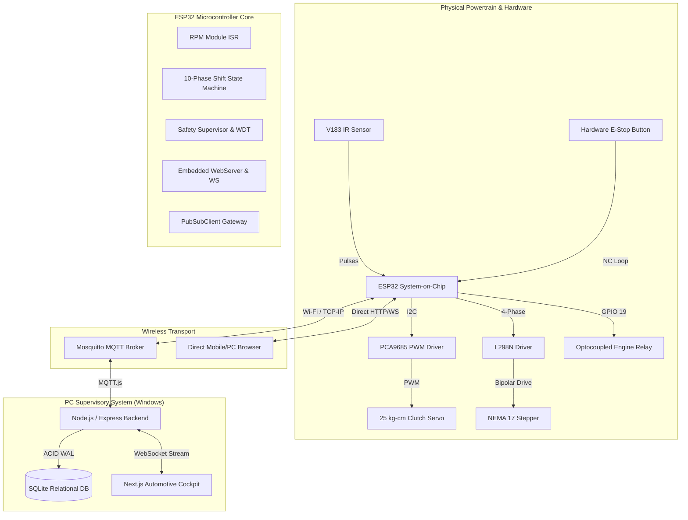
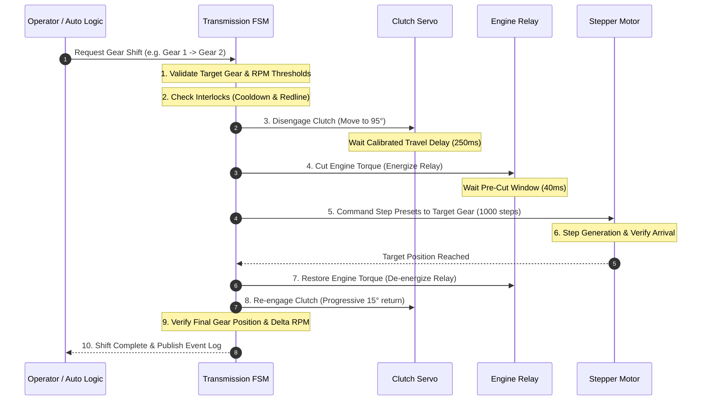
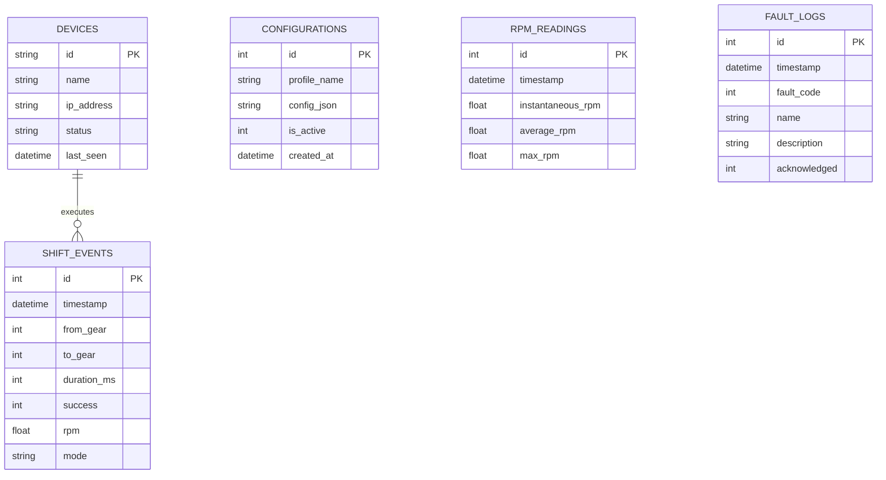

# System Architecture & Control Engineering Specification

## 1. Architectural Philosophy & Separation of Concerns

The AMT Control System operates under a strict dual-tier automotive architecture:

1. **Deterministic Embedded Core (ESP32):**
   - Retains 100% of real-time motor control, sensor interrupts, timing delays, and hardware failsafe responsibilities.
   - Operates completely autonomously. If Wi-Fi drops, MQTT disconnects, or the PC reboots, the ESP32 safety supervisor continues real-time shifting, watchdog monitoring, and emergency stop protection without interruption.

2. **Supervisory Analytics & Cockpit Tier (PC Local Host):**
   - High-level telemetry aggregation, time-series plotting, shift audit logging, parameter calibration, and predictive diagnostics.
   - Never directly pulses motor coils or blocks the microcontroller's hard real-time loop.

---

## 2. Shift Sequencing State Machine (10-Phase Interlock)

To prevent gear tooth clash, transmission bind, or overlapping movements, the transmission executes a deterministic 10-phase sequence:

---

## 3. SQLite Relational Database Architecture

